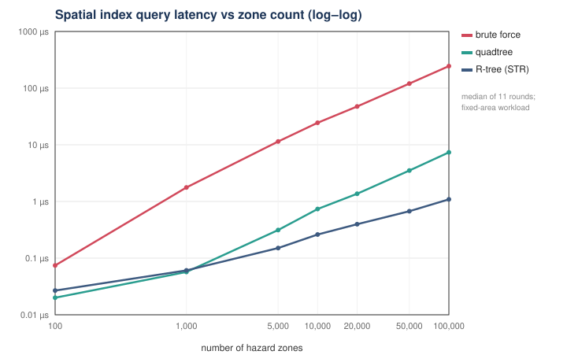

# Results

Every table on this page is **generated** from `bench/results/*.csv` by
`tools/render_results.py`; none is typed by hand. `make bench` writes the CSVs
and regenerates the tables, `make bench-variation` adds repeat runs for the
ranges, and CI fails if a committed table disagrees with the committed CSVs.

```bash
make bench             # every section below (~2–3 min), then re-render
make bench-variation   # sections 1-3 three more times, for the ranges
```

## Read this first

- **What is portable and what is not.** Absolute times belong to one machine in
  one state — the environment below records which, including power source and
  load (this run: <!-- results:machine -->Apple M4, Battery power, load average 2.91 at the start, commit 9d33bb6<!-- /results:machine -->). They
  drift between sessions: brute force over 100,000 zones measured 244 µs on 12
  September, again on 1 October and 239 µs on 9 October, but 460–560 µs in the
  runs committed on 28 September, on battery and on mains alike, for reasons not
  established. Ratios
  measured back to back, candidate counts, node counts, allocation counts and
  bytes are far more stable, so the docs quote ratios, with their range.
- **Ranges come in two sizes.** Within one session the runs agree closely: every
  headline ratio below is shown with its min–max over
  <!-- results:runs -->4<!-- /results:runs --> independent runs of one session.
  Between sessions they do not, and the R-tree — about a microsecond per query,
  the shortest timing here — moves most. At 100,000 zones in one district it
  measured 102–114× in the runs committed on 28 September (every contender 2–4×
  slower in absolute time, IQRs of 16–58% on that row), 97–229× in the set
  before that, 206×, 236× and 200× in three uncommitted clean-clone runs (the
  last on 1 October, quadtree 31×), 223–235× in the runs committed on 1 October,
  and 211–224× in the runs below (9 October). The quadtree's ratio has stayed
  within 26–35×. Read ~100× as the R-tree's floor on
  this machine and the tables as one session's measurement.
- **Measured, theoretical, simulated.** Everything on this page is measured.
  Bounds — O(log n + k) expected, O(min(n, (k + 1) log n)) for the interval
  tree — are theory, stated and checked against the code in
  [DATA_STRUCTURES.md](DATA_STRUCTURES.md). Zones in §1–9 are synthetic; §10
  and §18 use the real OpenStreetMap zones (§18 adds synthetic ones); people and
  their GPS error are simulated everywhere.
- **Identical across platforms, or not.** Counts — candidates, nodes,
  allocations, events, the hysteresis tallies — are deterministic: identical run
  to run, and between the Make and CMake builds. Across operating systems one
  run is gated: since 2026-10-22 CI fails unless the default dashboard page
  built on macOS (Apple clang, libc++) and on Linux (g++, libstdc++) are
  byte-identical ([TESTING.md](TESTING.md) §7). The counts on this page come
  from `make bench`, which that gate does not run, and are not compared across
  operating systems; the 2026-09-05 macOS/Linux comparison matched in the
  evaluation core and differed in the dispatch travel totals (§12), whose
  `libm` calls differ in the last ulp, and the 2026-10-22 comparison of the
  whole dashboard found one more cause, since fixed: an incident ranking with
  no tie-break, ordered differently by libc++ and libstdc++. Times are never
  portable.
- **Speedups are against this project's own brute force**, the correctness
  oracle — not against PostGIS, Boost.Geometry or any library.
- **Simulated people, real geography.** Benchmarks use synthetic zones in a
  real district's extent; the engine's end-to-end runs use real OpenStreetMap
  zones around Shillong with simulated tourists (simulation provides ground
  truth).
- **Every comparison is also a correctness gate.** Contenders that do the same
  job return a checksum of their results; the run fails if any differ.

<!-- results:env -->
```
date:     2026-10-30T08:30Z
commit:   9d33bb6
compiler: Apple clang version 17.0.0 (clang-1700.4.4.1)
flags:    -std=c++17 -O2 -ffp-contract=off
os:       Darwin 27.0.0 arm64
cpu:      Apple M4
cores:    10
power:    Battery Power
load:     2.91 3.13 2.84
```
<!-- /results:env -->

### Protocol

Query boxes are built before timing, so a query time is index traversal only.
One *sample* runs the whole probe set enough times to last at least 20 ms
(calibrated per contender after an untimed warm-up); **11 rounds**, each
contender taking one sample per round in an order rotated round to round, so
drift lands on every contender rather than on whichever ran last. Reported:
the median, and the interquartile range as a percentage of it. A **speedup is
paired**: the median over rounds of *baseline ÷ contender* measured back to
back. On macOS the process requests the performance cores (QoS
user-interactive); that is a request, and the pairing is what keeps ratios
meaningful if it is not honoured. The previous protocol — the median of 7
passes of ~2 ms each, one index after another — is what produced headline
numbers this protocol could not reproduce ([DEFECT_LOG.md](DEFECT_LOG.md),
pass 6).

---

## 1. Scaling in one district — k grows with n

2,000 random 450 m query boxes against n zones (boxes 60–480 m across) in one
39 × 35 km district. Because the area is fixed, the number of zones genuinely
overlapping each query, **k**, grows in proportion to n.

<!-- results:scaling -->
| zones | brute µs | quadtree µs | R-tree µs | quadtree × | R-tree × | k / query | quadtree × range | R-tree × range | worst IQR |
|---:|---:|---:|---:|---:|---:|---:|---:|---:|---:|
| 100 | 0.074 | 0.020 | 0.027 | **3.66×** | **2.79×** | 0.10 | 3.66–3.84× | 2.79–2.92× | 8% |
| 1,000 | 1.77 | 0.057 | 0.061 | **30.8×** | **29.3×** | 0.97 | 30.8–31.8× | 29.3–30.8× | 6% |
| 5,000 | 11.4 | 0.313 | 0.150 | **35.6×** | **77.6×** | 4.88 | 35.6–40.0× | 77.2–88.8× | 34% |
| 10,000 | 24.5 | 0.736 | 0.261 | **33.2×** | **93.8×** | 9.77 | 33.2–36.4× | 93.8–102× | 13% |
| 20,000 | 47.5 | 1.37 | 0.397 | **34.6×** | **120×** | 19.80 | 33.5–34.9× | 118–120× | 9% |
| 50,000 | 120 | 3.52 | 0.673 | **34.0×** | **179×** | 49.22 | 33.1–34.3× | 174–179× | 6% |
| 100,000 | 245 | 7.35 | 1.09 | **32.7×** | **224×** | 98.45 | 31.7–33.5× | 211–224× | 6% |
<!-- /results:scaling -->

Brute force is linear. The trees are O(log n + k) and here **k dominates**: at
100,000 zones about a hundred zones really do overlap each query, and every
index must return all of them. That caps the speedup — no index returns fewer
results than exist — and it is why the quadtree's ratio stops growing after a
few thousand zones instead of rising with n. The R-tree keeps gaining because STR packing lets it
reach those k results through fewer nodes. The candidate counts are identical
across indexes by construction; the checksum gate verifies it on every row.



## 2. Scaling at constant density — k held near 1

The same experiment with the district's area growing in proportion to n, so
each query overlaps about one zone at every size.

<!-- results:density -->
| zones | brute µs | quadtree µs | R-tree µs | quadtree × | R-tree × | k / query | quadtree × range | R-tree × range | worst IQR |
|---:|---:|---:|---:|---:|---:|---:|---:|---:|---:|
| 1,000 | 1.87 | 0.066 | 0.066 | **30.1×** | **29.0×** | 0.97 | 28.1–31.7× | 29.0–31.1× | 16% |
| 10,000 | 21.2 | 0.151 | 0.112 | **139×** | **189×** | 1.03 | 126–139× | 174–189× | 12% |
| 100,000 | 219 | 0.391 | 0.213 | **556×** | **1027×** | 0.99 | 423–556× | 845–1027× | 9% |
<!-- /results:density -->

With k fixed, what is left is the tree's depth, and the speedup keeps rising
with n — hundreds of times at 100,000 zones. Sections 1 and 2 together are the
honest answer to "how does it scale?": the index removes the O(n) scan; it
cannot remove the answer.

## 3. End to end — "which zones contain this point?"

The question the engine actually asks for each GPS fix, answered four ways that
must return the same set: **naive** ray-casts every polygon (O(n·V));
**bbox scan** tests every zone's box and ray-casts the hits (the brute-force
index plus exact geometry); **quadtree** and **R-tree** filter with the tree
first. 5,000 star-shaped polygons in the district, 300 probe points, V vertices
per polygon.

<!-- results:e2e -->
| V | naive µs | bbox scan µs | quadtree µs | R-tree µs | quadtree vs naive | range | quadtree vs scan | range | candidates / q | hits / q |
|---:|---:|---:|---:|---:|---:|---:|---:|---:|---:|---:|
| 8 | 17.4 | 9.60 | 0.101 | 0.063 | **172×** | 168–173× | 94.8× | 90.3–94.8× | 0.18 | 0.11 |
| 32 | 58.1 | 9.75 | 0.113 | 0.081 | **511×** | 497–536× | 85.9× | 81.3–86.8× | 0.30 | 0.18 |
| 128 | 255 | 9.66 | 0.170 | 0.123 | **1498×** | 1461–1552× | 56.8× | 53.1–57.0× | 0.28 | 0.16 |
| 512 | 951 | 10.2 | 0.396 | 0.338 | **2405×** | 2405–2513× | 25.6× | 24.5–25.6× | 0.34 | 0.16 |
<!-- /results:e2e -->

The large factors against *naive* are what "check every zone against every
tourist" really costs. A plain bounding-box scan already removes the V; the
tree then removes the n. The exact test on the few candidates is identical in
every column, which is why the tree's advantage over the scan shrinks as V
grows — it accelerates the filter, not the refinement.

## 4. Build, memory, updates

Build is the median of 5. Memory is `IndexStats::bytes`: nodes plus the
capacity of every vector they own, allocator overhead excluded. Insert and
remove are the median over 7 rounds of 1,000 operations on a freshly built
index.

<!-- results:costs -->
| zones | index | build ms | memory KB | bytes / zone | insert µs | remove µs |
|---:|---|---:|---:|---:|---:|---:|
| 10,000 | brute-force | 0.01 | 391 | 40 | 0.002 | 3.25 |
| 10,000 | quadtree | 0.80 | 699 | 72 | 0.081 | 3.60 |
| 10,000 | r-tree | 1.21 | 527 | 54 | 0.381 | 5.15 |
| 100,000 | brute-force | 0.09 | 3,906 | 40 | 0.003 | 31.4 |
| 100,000 | quadtree | 7.95 | 6,618 | 68 | 0.085 | 35.6 |
| 100,000 | r-tree | 16.23 | 5,255 | 54 | 0.669 | 58.8 |
<!-- /results:costs -->

Removal is O(n) in all three indexes: none keeps an id → node map, so the entry
is found by search, and the trees then pay again to collapse or condense. That
is a deliberate simplification for a read-heavy workload, measured rather than
hidden; an id → leaf hash map is the first change for a churn-heavy one.

## 5. Equivalence

`make bench` §5 checks every index against brute force on 18,000 queries at
three radii and three densities; `tests/index/differential_test.cpp` runs about
275,000 more over seven hostile workload profiles with structural audits after
every operation ([TESTING.md](TESTING.md)). Zero mismatches in both.

## 6. Two point-in-polygon implementations

Ray casting vs winding number: 100,000 points against 200 random concave
polygons, **0 disagreements** (`make bench` §6; holes in every orientation are
covered by `tests/geo/polygon_holes_test.cpp`).

## 7. R-tree bulk loading — STR vs repeated insertion

Same data, same queries; only the way the tree was assembled changes.

<!-- results:str -->
| zones | insertion build ms | STR build ms | insertion nodes | STR nodes | insertion µs / query | STR µs / query | STR query gain |
|---:|---:|---:|---:|---:|---:|---:|---:|
| 1,000 | 0.1 | 0.1 | 214 | 155 | 0.139 | 0.065 | **2.13×** |
| 10,000 | 2.0 | 1.3 | 2,133 | 1,456 | 1.34 | 0.234 | **5.74×** |
| 100,000 | 26.7 | 16.2 | 21,368 | 14,383 | 6.36 | 1.02 | **6.26×** |
<!-- /results:str -->

Both builds are O(n log n). STR produces a smaller tree whose sibling boxes
overlap less, so a query enters fewer branches — the structure, not the machine.

## 8. Interval tree — stabbing vs a linear scan

"Which validity windows contain instant t?", in two regimes. **Selective**:
windows of 1–30 minutes spread over 30 days. **Dense**: a tenth as many start
times as windows, each lasting up to 4 hours, so hundreds contain any instant.
Churn: ten rounds of deleting and reinserting a tenth of the set.

<!-- results:interval -->
| regime | windows | scan µs | tree µs | tree × | k / stab | height | AVL bound | height after churn | delete µs |
|---|---:|---:|---:|---:|---:|---:|---:|---:|---:|
| selective | 1,000 | 0.310 | 0.022 | **14.2×** | 0.3 | 12 | 14.0 | 12 | 0.105 |
| selective | 10,000 | 3.05 | 0.053 | **57.4×** | 3.6 | 16 | 18.8 | 16 | 0.143 |
| selective | 100,000 | 30.4 | 0.576 | **52.8×** | 36.0 | 20 | 23.6 | 20 | 0.247 |
| dense | 1,000 | 1.04 | 1.72 | **0.61×** | 363.2 | 12 | 14.0 | 12 | 0.122 |
| dense | 10,000 | 8.76 | 8.62 | **1.02×** | 980.5 | 16 | 18.8 | 16 | 0.164 |
| dense | 100,000 | 38.6 | 18.2 | **2.12×** | 1192.3 | 20 | 23.6 | 20 | 0.247 |
<!-- /results:interval -->

Selective windows are where the `max_high` augmentation earns its keep. With
hundreds of windows containing every instant the tree must still visit and
report each one: it loses to the scan when a third of 1,000 windows contain t,
and is at most a small factor ahead at 100,000, where about 1% do. The bound
says exactly this:
reporting k windows costs O(min(n, (k + 1) log n)) — a worst-case guarantee from
the AVL height, but not O(log n + k), because the prune admits a subtree as soon
as any window in it reaches past t, so each result can cost a root-to-leaf path.
Height stays under the AVL bound for the *live* size after churn. (This is also
why the engine does **not** use the interval tree per tick: it checks validity in
O(1) on the few candidates the spatial index returned.)

## 9. Persistent quadtree — path copying

Zones added one version at a time; "if full-copied" is what a copy-the-tree-per-
version scheme would have allocated. Then the cost of each kind of mutation on a
5,000-zone index.

<!-- results:persistent -->
| versions | nodes allocated | if full-copied | sharing | query @ past µs | query @ now µs |
|---:|---:|---:|---:|---:|---:|
| 51 | 523 | 1,903 | **3.6×** | 0.073 | 0.077 |
| 201 | 2,582 | 14,633 | **5.7×** | 0.100 | 0.104 |
| 1,001 | 14,025 | 158,257 | **11.3×** | 0.186 | 0.182 |
| 5,001 | 71,314 | 930,257 | **13.0×** | 0.525 | 0.885 |

| mutation (5,000-zone index) | nodes allocated, mean | max |
|---|---:|---:|
| add (new zone) | 14.7 | 15 |
| replace (moved zone) | 29.0 | 30 |
| validity change | 0.0 | 0 |
| remove | 14.3 | 15 |
<!-- /results:persistent -->

Sharing grows with history, a query against the past costs what one against the
present does (a different root pointer, no replay), and each mutation copies one
root-to-node path — a validity change copies nothing.

## 18. The evaluator per fix — including reconciliation

Sections 1–3 time the index on its own. This times the whole
`fence::Evaluator::evaluate()` — query box, index, validity, exact geometry,
hysteresis, transition diff, and the reconciliation step that observes every
zone with open state whether or not the index returned it — on one fixed set of
trajectories replayed from scratch each pass: 100 walkers, one fix a second for
5 minutes, 5 m or 35 m accuracy at random, and a 1.5 km jump every 150 s (the
GPS-gap case step 9 exists for), against the OpenStreetMap zones plus n
synthetic polygons in two regimes — packed into one district (k grows with n,
as in §1) and at constant density (k held, as in §2). It is `make bench`
section 18 and sits here because it is the hot loop, not an extension.

<!-- results:evaluator -->
| regime | zones | µs / fix | IQR | candidates / fix | exact tests / fix | reconciled / fix (step 9) | open states, mean | max | enter + exit | deterministic |
|---|---:|---:|---:|---:|---:|---:|---:|---:|---:|---:|
| one district | 1,038 | 2.24 | 1% | 3.38 | 3.35 | 0.08 | 3.35 | 15 | 145 | yes |
| one district | 5,038 | 4.98 | 1% | 13.95 | 13.92 | 0.36 | 13.93 | 36 | 499 | yes |
| one district | 20,038 | 17.2 | 1% | 52.47 | 52.44 | 1.42 | 52.49 | 106 | 2,028 | yes |
| constant density | 5,038 | 5.00 | 1% | 13.95 | 13.92 | 0.36 | 13.93 | 36 | 499 | yes |
| constant density | 20,038 | 5.27 | 2% | 13.81 | 13.79 | 0.36 | 13.80 | 33 | 608 | yes |
| constant density | 50,038 | 5.74 | 3% | 13.73 | 13.70 | 0.36 | 13.71 | 35 | 566 | yes |
<!-- /results:evaluator -->

µs/fix tracks candidates/fix: the exact geometry on k candidates is the cost of
a fix, so the district rows grow with n — the same crowding ceiling as §1 — and
the constant-density rows barely move while n grows 10×: what is left is the
tree's extra depth, which is the index doing its job. Reconciliation is the step-9 column: the zones a walker has open state
with that the index did *not* return this fix, a fraction of a zone per fix, each
a bounding-box distance and a hysteresis update, no geometry. The open-state
columns are the per-walker memory: one state per in-force candidate plus the
few unsettled out-of-window ones, bounded by the neighbourhood rather than by n
or by every zone the walker has ever been near. The gate is determinism: two
replays must produce identical events.

---

## Extensions (§10–17)

Built on the core; not part of the headline claim. Full tables are in the CSVs
named after each section.

<!-- results:extensions -->
| Extension | § | Measured |
|---|---|---|
| Hysteresis A/B | §10 | white noise (rho=0): filter removes 100.9% of the naive run's excess transitions and reports 343 vs 521 that noise-free fixes give under the same policy; realistic drift (rho=0.9): filter removes 100.1% of the naive run's excess transitions and reports 502 vs 521 that noise-free fixes give under the same policy |
| A* vs Dijkstra | §11 | 77.7% fewer nodes settled at 1,024 nodes, same path |
| Hungarian vs greedy dispatch | §12 | 15.7% less total travel at 40 responders; never worse in any of 200 layouts |
| Adaptive GPS sampling | §13 | 28,800 → 257 fixes over an 8 h trek (99.1% fewer) at 100.0% near-zone recall |
| Index churn (20 × add/remove 2,000) | §14 | quadtree 1.00×, r-tree 1.57×, geohash 1.00×, hash_table 1.00× node count vs fresh |
| Geohash serialisation | §15 | 44 bytes / zone; 100,000 zones read in 0.38 ms |
| Shamos–Hoey vs pairwise validation | §16 | sweep first wins at 96 vertices; 5.83× at 2,048; verdicts agree on every ring |
| k-d tree vs linear snap | §17 | 48.2× at 10,000 junctions, same node every time |
<!-- /results:extensions -->

## Test suite and verification

Not benchmarks, but the numbers people ask for next — see
[TESTING.md](TESTING.md) for what each means. The suite is
`make test`; the whole of it runs under UBSan locally and ASan + UBSan in Linux
CI; `make mutation` kills 23 of 23 injected bugs; `make determinism` checks
byte-identical output for a fixed seed.
