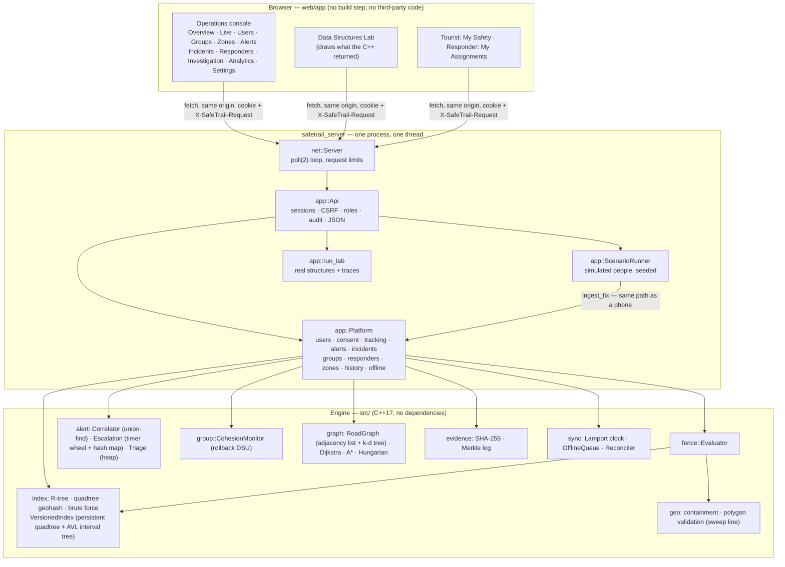
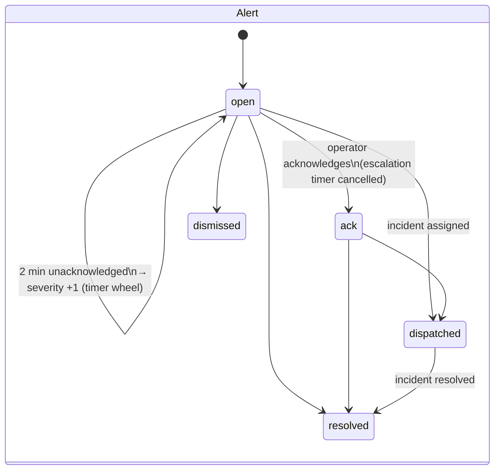

# Architecture

SafeTrail has three layers: the **engine** (data structures, geometry,
geofencing — present before the final phase), the **platform** (users,
consent, sessions, alerts, incidents, groups, responders, history, offline
sync), and the **server and web app** (HTTP API, scenario runner, operations
console, Data Structures Lab). The static dashboard (`make dashboard`, deployed
to GitHub Pages and Vercel) is a fourth, independent product: a replay of one
simulated run. The engine's pipeline and design decisions are described in
detail in [../ARCHITECTURE.md](../ARCHITECTURE.md).

## 1. Layers



## 2. One GPS fix, end to end

```mermaid
sequenceDiagram
  participant Phone as Phone (or scenario runner)
  participant API as app::Api
  participant P as app::Platform
  participant E as fence::Evaluator
  participant C as alert::Correlator
  participant M as evidence::MerkleLog
  Phone->>API: POST /api/users/7/fix {lat, lon, accuracy_m, t_ms}
  API->>API: session → principal; CSRF header; role
  API->>P: ingest_fix(principal, 7, fix)
  P->>P: consent + session? valid numbers? duplicate? older than last? jump?
  P->>P: append to trail (time-sorted)
  P->>E: evaluate(user 7's Tourist, t)
  E->>E: R-tree prune → validity O(1) → exact containment → hysteresis → transitions → prediction → reconciliation
  E-->>P: events (enter / exit / uncertain / approaching / dwell)
  P->>M: one log entry per event (ids only, no coordinates)
  P->>C: incident-worthy alerts
  C-->>P: incident opened or extended
  P->>P: recommend nearest responder (one Dijkstra from the incident)
  API-->>Phone: {"status":"accepted","events":1}
```

## 3. Life cycles

```mermaid
stateDiagram-v2
  direction LR
  [*] --> Open: correlated alerts
  Open --> Acknowledged: operator / assigned responder
  Open --> Dispatched: assign (A* route; responder busy)
  Acknowledged --> Dispatched
  Dispatched --> Dispatched: reassign (old responder freed)
  Dispatched --> Resolved: resolve (responder freed, alerts resolved)
  Acknowledged --> Resolved
  Open --> Resolved
```





## 4. Offline phone

```mermaid
sequenceDiagram
  participant D as Phone (offline)
  participant S as Server
  Note over D: go_offline: copy of zones +<br/>geohash index shipped as bytes
  loop every fix while offline
    D->>D: evaluate locally (own Evaluator)
    D->>D: OfflineQueue.append(payload, Lamport stamp, device clock)
  end
  Note over S: no fixes for 2 min → SignalLost alert<br/>(server knows only the last contact)
  D->>S: reconnect: upload queue (and a retry)
  S->>S: Reconciler.merge — hash-set de-dup, order by (counter, device)
  S->>S: correct clock skew; apply events as LATE; adopt phone's engine state
  S->>S: SignalLost resolved; late alerts correlated
```

## 5. Concurrency and ordering

The server is single-threaded on purpose. `net::Server::run` multiplexes all
sockets with `poll(2)`, calls the API handler for each complete request, and
between wake-ups advances the simulation clock. Every mutation of the platform
therefore happens in one total order, the order of the event log, with no lock
anywhere. Per user, fixes must arrive in time order to be evaluated (the
hysteresis filter is a state machine over time); late fixes are recorded but
not replayed. Measured cost: about 3–4 µs per fix through the whole ingestion
path, flat from 10 to 5,000 users (benchmark section 19).

## 6. Time

The platform clock is milliseconds since the platform's own start. In demo
mode the scenario runner advances it (pause really stops time; 0.25×–60×
speeds); in production mode it follows the wall clock. Every log entry and
trail point records both the time an event happened and the time the server
learned of it, which is what lets the Investigation page answer "what did the
system know at t?".

## 7. Repository map

| Path | Contents |
|---|---|
| `include/safetrail/`, `src/` | engine (`geo`, `index`, `ds`, `fence`, `track`, `alert`, `group`, `graph`, `dispatch`, `sync`, `evidence`, `power`, `jurisdiction`, `sim`, `viz`, `util`), platform (`app`), HTTP (`net`) |
| `apps/` | `safetrail_server`, `safetrail_headless` (CLI + static dashboard), `safetrail_bench` |
| `web/app/` | the operations console and Lab (HTML, CSS, ES modules) |
| `tests/` | 51 test files: unit, property, differential, golden, platform, API, HTTP |
| `tools/` | benchmark rendering, mutation check, end-to-end HTTP check, OSM converters |
| `data/` | OSM hazard zones and road network around Shillong |
| `bench/results/` | committed benchmark CSVs (the evidence the reports quote) |
| `docs/final/` | the final academic documentation (this folder) |
