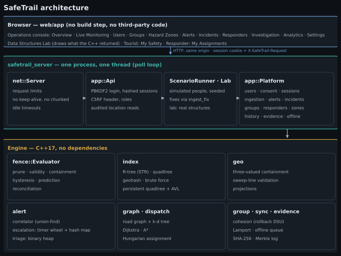
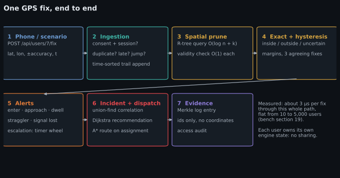
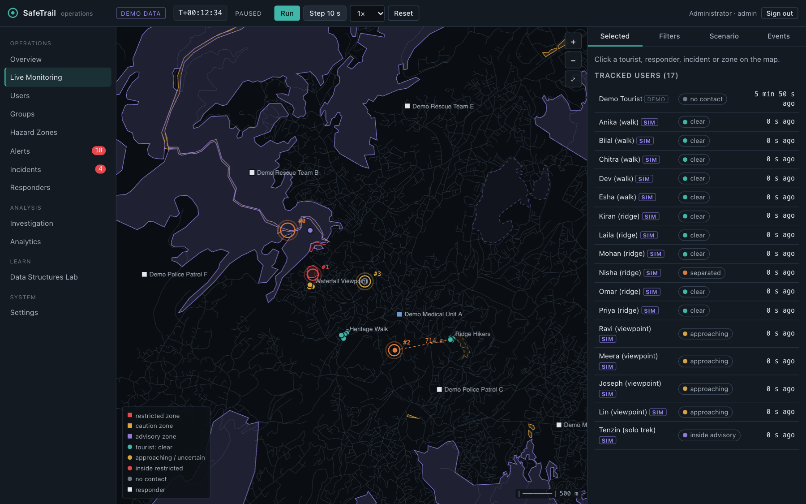
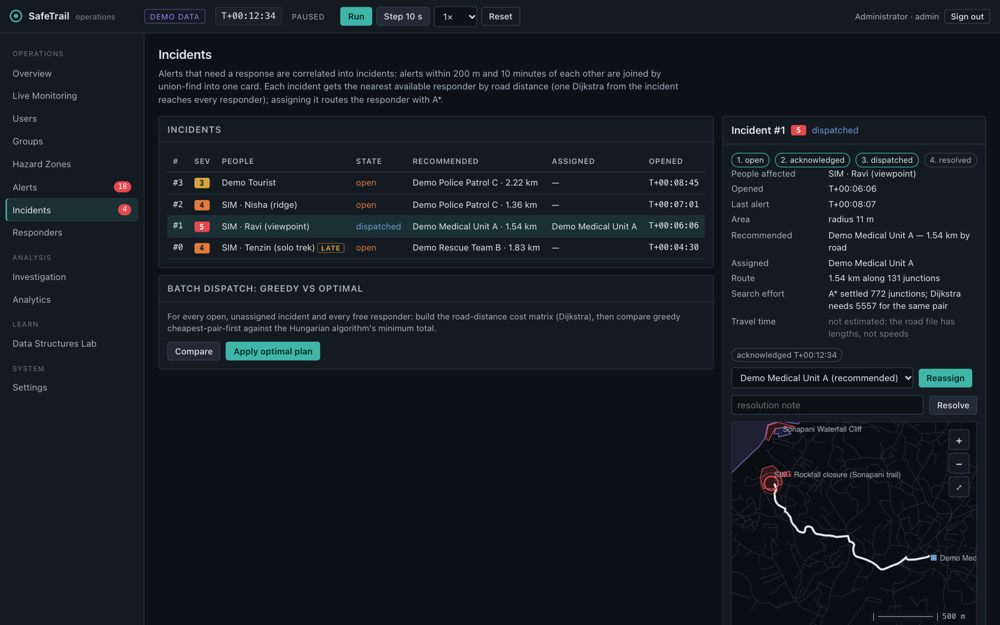
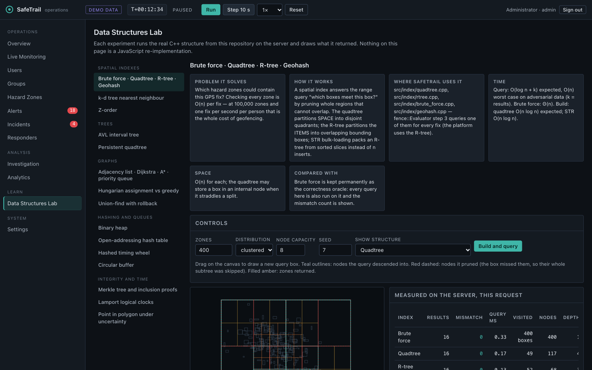
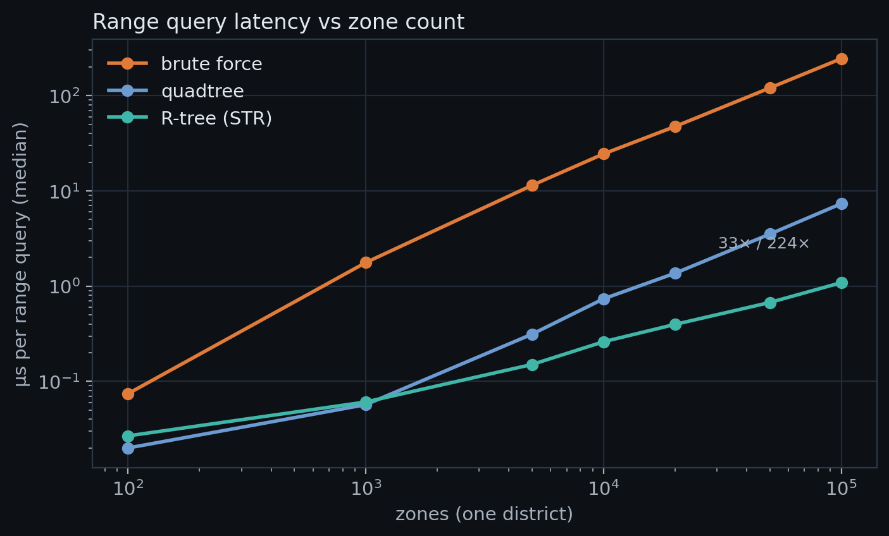
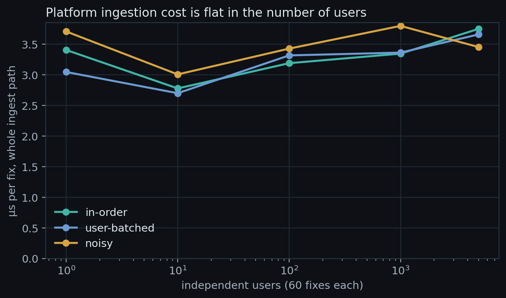

# SafeTrail: Geofencing and Incident Response for Tourist Safety on Hand-Built Data Structures

**Data Structures — Course Project Report**

Author: Adi Vishal (`adivishall`) · Institution: [fill in] · Guide: [fill in] · October 2026

Repository: https://github.com/adivishall/safetrail

---

## Abstract

Tourists in hilly, low-connectivity regions such as Meghalaya are exposed to
hazards — cliffs, rivers, closed roads — exactly where their phones lose
signal, and help is delayed when nobody knows who is where. SafeTrail is a
geofencing and incident-response system that tracks people who opt in, checks
each GPS fix against hazard zones while treating GPS error as a disc rather
than a point, turns confirmed transitions into alerts, correlates related
alerts into incidents, routes the nearest responder along the road network,
detects separated group members, keeps working on a phone with no network and
reconciles on reconnect, and keeps a tamper-evident history. The repeated
containment query is the system's dominant cost, so it is built on
hand-implemented data structures: brute force (as an oracle), a quadtree, an
STR-packed R-tree, an AVL interval tree for validity windows and a persistent
quadtree for history, supported by a binary heap, an open-addressing hash
table, rollback union-find, a hashed timing wheel, a ring buffer, a k-d tree,
graph searches (Dijkstra, A*), Hungarian assignment, Lamport clocks and a
Merkle log. On 100,000 zones in one district the R-tree answers the index query
224× faster than a linear scan and the quadtree 33×, with identical results;
the complete platform ingests a fix in about 3 µs, independent of the number of
users up to 5,000. Correctness is established by oracles, invariant audits,
51 test files (12,137 checks), an end-to-end HTTP test, and mutation testing
(28 of 28 injected bugs caught). The people in all demonstrations are
simulated; the geography is real OpenStreetMap data.

## 1. Introduction

Geofencing — deciding whether a moving person is inside a region — is simple
for one person and one region and expensive at scale: each fix must be tested
against every region that could contain it. This project treats that cost as a
data-structures problem and builds, measures and verifies the structures that
reduce it, then builds a complete, operable product around them: user
accounts with consent, live multi-user tracking, alerting, incident management,
dispatch, group monitoring, offline operation and historical investigation,
with a web console and an interactive laboratory that shows the structures
working.

## 2. Problem definition

Given a set Z of polygonal hazard zones (each with a category, severity,
validity window and optional dwell limit), a road network G = (V, E), a pool of
responders, and a stream of GPS fixes (position, accuracy radius, time) from
users who have consented to tracking:

1. for each fix, decide for every zone that could contain the user whether
   they are inside, outside or uncertain, and report only **changes**;
2. raise alerts for entries, imminent crossings, dwell overruns, separation
   from a group, inactivity and loss of signal, and group related alerts into
   incidents;
3. recommend and route the nearest available responder over G;
4. answer "what did the system know at time t?" for any past t, with evidence
   that the record was not altered;
5. do all of this per user independently, with fixes that may be duplicated,
   late or noisy, and with phones that may be offline for minutes.

## 3. Motivation

Smart India Hackathon 2025 problem SIH25002 (Ministry of DoNER) asked for a
tourist-safety system for the North-East. Existing implementations delegate the
interesting computation to a spatial database or a blockchain and assume
connectivity ([../GAP_ANALYSIS.md](../GAP_ANALYSIS.md)). This project builds
those pieces instead — which is both what a data-structures course is about and
what makes an offline, verifiable, explainable system possible.

## 4. Objectives

1. Implement spatial and temporal indexes by hand and show, with measurements,
   that they make repeated geofencing faster **without changing any answer**.
2. Handle GPS uncertainty and boundary noise so alerts are trustworthy.
3. Build an integrated multi-user product: consent, tracking sessions, alerts,
   incidents, groups, responders, history, offline sync, a web console.
4. Make the data structures visible: an interactive lab driven by the real code.
5. Establish correctness with oracles, invariants and mutation testing.
6. Respect privacy: opt-in, minimal data, retention, erasure, audited access.

## 5. Existing approaches

| Approach | Typical choice | Limitation addressed here |
|---|---|---|
| Geofencing services | PostGIS `ST_Contains`, cloud geofencing APIs | need connectivity; opaque cost |
| Tourist-safety prototypes (SIH entries) | full-stack app + spatial DB + blockchain ID | no offline evaluation, no uncertainty, alert floods |
| Textbook point-in-polygon | ray casting on a point | ignores GPS error; no index |
| Spatial indexing literature | R-trees (Guttman 1984), quadtrees (Finkel & Bentley 1974), STR (Leutenegger et al. 1997) | used here, measured against brute force |

## 6. Proposed methodology

- **Filter and refine:** a spatial index returns candidate zones whose bounding
  boxes meet the fix's uncertainty box (conservative), then exact geometry
  decides inside / outside / uncertain.
- **Transitions, not states:** a hysteresis filter (asymmetric margins, three
  agreeing fixes, minimum dwell) turns noisy readings into confirmed changes.
- **Every claim against an oracle:** brute force for indexes, linear scans for
  trees, full replays for history.
- **One writer:** a single-threaded server applies every update in one total
  order; per-user state is isolated by construction.
- **History as data structures:** a persistent quadtree for zone versions, an
  interval tree for validity, an append-only Merkle log for events.

## 7. Architecture

Three layers (details in [ARCHITECTURE.md](ARCHITECTURE.md)): the **engine**
(geometry, indexes, the nine-step evaluator, alerting, groups, graphs, sync,
evidence), the **platform** (`app::Platform`: users, consent, sessions,
ingestion, alerts, incidents, groups, responders, zones, history, offline
devices) and the **server** (`safetrail_server`: HTTP, authentication, API,
scenario runner, data-structures lab) with a browser console.

## 8. Data structures

| Structure | Role | Bound |
|---|---|---|
| Brute force | oracle and baseline | Θ(n) |
| Quadtree | spatial index (space partition) | O(log n + k) expected |
| R-tree, STR bulk load | spatial index (item partition); platform's live index | O(log n + k) expected |
| Geohash (Morton order) | flat index shipped to offline phones | O(log n) lookups |
| k-d tree | nearest road junction | O(log n) expected |
| AVL interval tree | validity windows over time | O(log n) update; stab O(min(n, (k+1) log n)) |
| Persistent quadtree | every past zone configuration | O(depth) nodes per change |
| Binary heap | Dijkstra/A* frontier; alert triage | O(log n) |
| Open-addressing hash table | users, sessions, escalation, sync dedup | O(1) expected |
| Rollback union-find | group cohesion; alert correlation | O(log n) |
| Hashed timing wheel | alert escalation deadlines | O(1) schedule |
| Ring buffer | last 64 fixes per person | O(1) |
| Merkle tree | evidence and audit logs | O(log n) proofs |

Each is explained in [DATA_STRUCTURES_EXPLAINED.md](DATA_STRUCTURES_EXPLAINED.md)
and mapped to the syllabus in [SYLLABUS_MAPPING.md](SYLLABUS_MAPPING.md).

## 9. Algorithms

Ray casting and winding number (point in polygon); signed distance against the
accuracy radius (three-valued containment); Shamos–Hoey sweep line with an AVL
status tree (polygon validation); STR packing; Guttman quadratic split; path
copying; Dijkstra and A* with lazy deletion; the Hungarian algorithm; union by
rank with rollback; connected-component clustering in space and time;
linear-probing hashing; Lamport ordering and idempotent merge; RFC 6962 Merkle
inclusion proofs; PBKDF2-HMAC-SHA256. Complexities are tabulated in
[ALGORITHM_COMPLEXITY.md](ALGORITHM_COMPLEXITY.md).

## 10. Implementation

C++17 with no dependencies beyond the standard library and POSIX sockets
(about 27,800 lines of C++ in `src/`, `include/`, `apps/` and `tests/`, plus about 3,400 lines of HTML, CSS and JavaScript), built with
make or CMake under strict warnings (`-Werror`, conversion warnings on clang),
`-ffp-contract=off` for cross-compiler determinism. The web console is plain
HTML, CSS and JavaScript modules with no build step and no third-party code;
its map draws the OpenStreetMap road graph itself, so no tile service is
needed. Platform design decisions:

- **Isolation:** each user owns their engine state; nothing per-user is shared.
- **Ordering:** late fixes are recorded but not evaluated (the hysteresis
  filter is a state machine over time); duplicates are dropped and counted.
- **Incident policy:** confirmed breaches (severity ≥ 3), dwell overruns,
  stragglers, stationary users, lost signal and SOS open incidents;
  approaching/uncertain are warnings that settle themselves.
- **Separation:** a straggler alert only after separation outlasts the group's
  confirmation time (default 60 s).
- **Recommendation:** one Dijkstra from the incident reaches every responder
  (valid because the road graph is undirected); A* routes the chosen one.
- **Offline:** the phone evaluates locally from an index shipped as bytes; the
  server reconciles by Lamport order, de-duplicates, corrects clock skew, and
  adopts the phone's state.
- **Evidence:** log entries carry ids, never coordinates, so erasure does not
  conflict with an append-only log.

## 11. User interface and system workflow

The console has an Overview, Live Monitoring (map, filters, selection detail,
scenario controls), Users, Groups, Hazard Zones (draw, edit, validity, GeoJSON
import, version history), Alerts (triage order), Incidents (acknowledge, assign
with route, resolve, greedy-vs-Hungarian planning), Responders, Investigation
(past state and evidence verification), Analytics, the Data Structures Lab and
Settings; tourists get "My Safety" (consent, sharing switch, SOS, erasure) and
responders "My Assignments".

The end-to-end workflow (scenario "Complete walkthrough"): an operator creates
groups; simulated tourists join, consent and start sharing; their positions
appear; one approaches a restricted closure (approaching → uncertain → entry);
an incident opens with the nearest responder by road distance; a hiker is
injured and the group's proximity graph splits — after 60 s a straggler alert
joins her incident; a trekker's phone goes offline, keeps evaluating, and
reconciles on reconnect; the operator acknowledges, assigns (A* route) and
resolves; the investigation view replays what was known at any time.

## 12. Experiments

All measurements: Apple M4 laptop, Apple clang 17, `-O2`, commit 9d33bb6,
recorded in `bench/results/environment.txt`. Protocol: precomputed inputs,
samples ≥ 20 ms, 11 interleaved rounds, medians with IQR, paired ratios,
checksums as correctness gates ([../RESULTS.md](../RESULTS.md)).

1. Index range query versus zone count, in one district and at constant density.
2. R-tree built by insertion versus STR packing.
3. Interval tree versus linear scan, selective and dense windows.
4. Persistent index: nodes allocated versus full copies; past versus present query cost.
5. Dijkstra versus A*; greedy versus Hungarian dispatch.
6. Hysteresis A/B under two GPS noise models; adaptive sampling.
7. The whole evaluator per fix as zones grow.
8. **Multi-user platform ingestion**: 1–5,000 users, three update patterns.

## 13. Results

| Result | Value |
|---|---|
| R-tree vs brute force, 100,000 zones in one district (k ≈ 98) | 224× (245 µs → 1.09 µs) |
| Quadtree vs brute force, same | 32.7× |
| Constant density (k ≈ 1), 100,000 zones | quadtree 556×, R-tree 1027× |
| STR vs insertion-built R-tree, 100,000 zones | 6.3× faster queries; 14,383 vs 21,368 nodes |
| Interval tree, selective windows | 14–57× faster than a scan; slower (0.61×) for dense windows at 1,000 |
| Persistent index, 1,001 versions | 14,025 nodes vs 158,257 for full copies (11.3×) |
| A* vs Dijkstra | 71–78 % fewer nodes settled |
| Hungarian vs greedy | 6.5–15.7 % less total travel |
| Hysteresis, realistic drift | 16,168 naive transitions → 502 (target 521) |
| Whole evaluator per fix, constant density | 5.0 µs at 5,038 zones, 5.7 µs at 50,038 |
| Platform ingestion | 2.7–3.8 µs per fix, flat from 10 to 5,000 users; ≈ 6.9 KB per tracked user |

Every index returned exactly the brute-force answer in every gate. Absolute
times move between sessions on a laptop (the R-tree ratio has ranged about
100–235×), so ratios are quoted with ranges in RESULTS.md.

## 14. Complexity analysis

The spatial indexes are O(log n + k) expected and O(n) worst case; the speedup
over brute force is bounded by the answer size k, which is why it plateaus in a
crowded district and keeps growing at constant density. The AVL tree's height
bound is guaranteed. Persistence costs O(depth) per change instead of O(n) per
version. Platform ingestion is O(1) plus one evaluation plus bookkeeping
proportional to the user's own alerts — measured flat in the number of users.
Full tables: [ALGORITHM_COMPLEXITY.md](ALGORITHM_COMPLEXITY.md).

## 15. Testing

| Method | Scale |
|---|---|
| Differential testing against oracles, invariant audits after every operation | ~55,000 queries per index |
| Engine end to end under all four indexes | byte-identical events |
| Platform: isolation, ingestion boundary, consent, access, evidence, scenarios | 4 test files |
| API in process; HTTP parser; real-HTTP end-to-end | 102 + 26 + 30 checks |
| Total suite | 51 files, 12,137 checks, 0 failed |
| Mutation testing | 28/28 injected bugs caught |
| Sanitizers, static analysis, cross-platform determinism | UBSan clean; ASan+UBSan in Linux CI; macOS vs Linux compared in CI |

Eight defects were found and fixed while the platform was built (for example
quadratic alert bookkeeping, found by the multi-user benchmark; stationary
alerts re-raised every tick, found by the scenario test), and twelve more by a
final verification pass before merging — among them a tourist able to read
another tourist's alert positions through an incident they shared, a login
path whose timing revealed which usernames exist, and client numbers cast to
integers without range checks. Each fix has a test that failed before it.
Details: [TESTING_AND_BENCHMARKS.md](TESTING_AND_BENCHMARKS.md).

## 16. Security and privacy

Opt-in tracking that only the user can start; no storage without consent;
role-based access checked twice; responders see a location only while
assigned; a tourist sees only their own data, including their own part of a
shared incident; every location read by someone else audited in a Merkle log;
retention and erasure; PBKDF2 passwords; hashed session tokens in HttpOnly,
SameSite=Strict cookies; CSRF header; login throttling; strict request limits
and CSP. Open items include in-process TLS and persistence
([SECURITY_AND_PRIVACY.md](SECURITY_AND_PRIVACY.md)). The integrated
application runs locally; only the static dashboard is hosted publicly
([DEPLOYMENT_GUIDE.md](DEPLOYMENT_GUIDE.md)).

## 17. Limitations

People are simulated; no field trial. The OSM hazard polygons are thin (rivers
25–40 m deep, the cliff about 23 m), so "uncertain" is often the honest answer.
The server keeps state in memory and runs one thread. Removal from the spatial
indexes is O(n). Benchmarks come from one laptop. The battery figure is a model.
A phone with a wrong clock judges zone validity on that clock while offline.
Full list: [LIMITATIONS_AND_FUTURE_SCOPE.md](LIMITATIONS_AND_FUTURE_SCOPE.md).

## 18. Future scope

Durable event log with signed Merkle roots; evaluation on real GPS traces; a
phone app running the same offline evaluator; per-user sharding across threads;
O(log n) index removal; travel-time routing; TLS, Argon2id and an external
security review.

## 19. Conclusion

The project shows that the expensive core of a safety system — repeatedly
asking which of many regions might contain each person — is a data-structures
problem with measurable answers, and that the answers can be made fast without
being made different. Around that core it delivers an operable multi-user
product whose every alert, route and historical claim can be traced to a data
structure, a test and a measurement.

## 20. References

1. A. Guttman. *R-trees: a dynamic index structure for spatial searching.* SIGMOD, 1984.
2. R. A. Finkel and J. L. Bentley. *Quad trees: a data structure for retrieval on composite keys.* Acta Informatica 4, 1974.
3. S. T. Leutenegger, M. A. Lopez, J. Edgington. *STR: a simple and efficient algorithm for R-tree packing.* ICDE, 1997.
4. J. L. Bentley. *Multidimensional binary search trees used for associative searching.* CACM 18(9), 1975.
5. G. M. Adelson-Velsky and E. M. Landis. *An algorithm for the organization of information.* 1962.
6. T. H. Cormen, C. E. Leiserson, R. L. Rivest, C. Stein. *Introduction to Algorithms*, 3rd ed., MIT Press, 2009 (interval trees, ch. 14; heaps, ch. 6; Dijkstra, ch. 24; disjoint sets, ch. 21).
7. J. R. Driscoll, N. Sarnak, D. D. Sleator, R. E. Tarjan. *Making data structures persistent.* JCSS 38, 1989.
8. E. W. Dijkstra. *A note on two problems in connexion with graphs.* Numerische Mathematik 1, 1959.
9. P. E. Hart, N. J. Nilsson, B. Raphael. *A formal basis for the heuristic determination of minimum cost paths.* IEEE Trans. SSC 4(2), 1968.
10. H. W. Kuhn. *The Hungarian method for the assignment problem.* Naval Research Logistics Quarterly 2, 1955.
11. R. E. Tarjan. *Efficiency of a good but not linear set union algorithm.* JACM 22(2), 1975.
12. L. Lamport. *Time, clocks, and the ordering of events in a distributed system.* CACM 21(7), 1978.
13. R. C. Merkle. *A digital signature based on a conventional encryption function.* CRYPTO, 1987.
14. G. Varghese and T. Lauck. *Hashed and hierarchical timing wheels.* SOSP, 1987.
15. M. I. Shamos and D. Hoey. *Geometric intersection problems.* FOCS, 1976.
16. G. M. Morton. *A computer oriented geodetic data base and a new technique in file sequencing.* IBM, 1966.
17. RFC 6962 / RFC 9162, *Certificate Transparency* (Merkle tree hashing and proofs).
18. RFC 2104 (HMAC); RFC 4231 (HMAC-SHA256 test vectors); RFC 8018 (PBKDF2); RFC 7914 §11 (PBKDF2-HMAC-SHA256 vectors).
19. NIST SP 800-132, *Recommendation for Password-Based Key Derivation*, 2010.
20. OpenStreetMap contributors, map data © OpenStreetMap contributors, ODbL ([../DATA_PROVENANCE.md](../DATA_PROVENANCE.md)).
21. Smart India Hackathon 2025, problem statement SIH25002, Ministry of Development of North Eastern Region.
