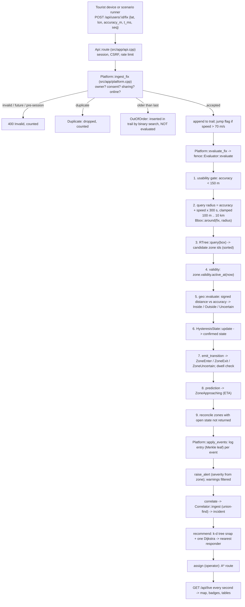
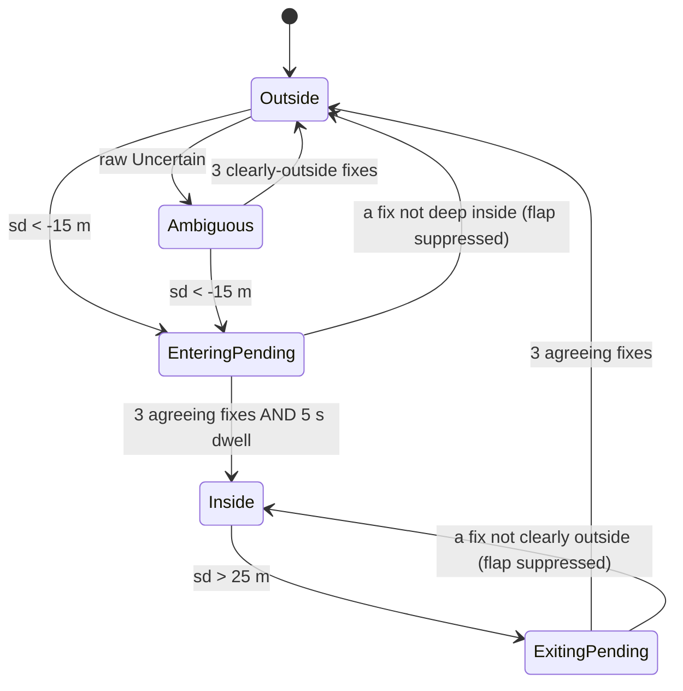

# 04 — The execution pipeline and the algorithms

> One GPS fix, traced through the real functions from the HTTP request to the
> red dot on the map, followed by every advanced algorithm the project actually
> implements. Anything simulated or library-only is labelled.

## 1. The pipeline at a glance



## 2. Stage by stage

### Stage 1 — A tourist generates a fix
- **Real device:** none exists; there is no phone app.
- **My Safety page:** a map click posts a fix at that point with the chosen
  accuracy (`web/app/js/pages/mine.js`).
- **Scenarios:** `ScenarioRunner` (`src/app/scenario.cpp`) moves simulated people
  along scripted paths and posts their fixes through the **same**
  `Platform::ingest_fix()` (as the system principal). Offline phones use
  `Platform::device_fix()`, which queues events on the simulated device.
- The benchmarks and static dashboard use `src/sim/` mobility models with a GPS
  error model: 4 m open sky, 35 m under multipath (25 % probability), and an AR(1)
  temporal correlation ρ (0 = white noise, 0.9 = realistic drift)
  (`include/safetrail/sim/mobility.hpp`).

### Stage 2 — The backend receives it
`POST /api/users/:id/fix` → `Api::handle()` (session cookie, CSRF header
`X-SafeTrail-Request: 1`, rate limits in public mode) → `Api::route()` → builds a
`FixInput {lat, lon, accuracy_m, t_ms, seq}` → `Platform::ingest_fix()`. The HTTP
status reflects the outcome: 200 for accepted/duplicate/out-of-order, 403 not
tracking, 409 device offline, 400 invalid.

### Stage 3 — Validation and ingestion (`Platform::ingest_fix`)
In order:
1. **Who:** a fix is accepted only from the user's own session (or the system
   principal). Otherwise `NotTracking`.
2. **Consent and session:** role tourist, active, consented, sharing — or the fix
   is **refused and stored nowhere** (no legal basis to keep it).
3. **Offline device:** refused with 409; the device queues it.
4. **Range checks:** finite coordinates, valid lat/lon, 0 < accuracy ≤ 5,000 m;
   timestamp not more than 60 s in the future, not before the session began.

### Stage 4 — Duplicate, late, noisy and missing fixes
| Case | Detection | Handling |
|---|---|---|
| **Duplicate** | same `seq`, or same time and same position | `Duplicate`, counted, nothing changes |
| **Late (out of order)** | timestamp before the last accepted fix (or lower seq) | inserted into the trail at its time with `std::upper_bound` (binary search), flagged `kTrailLate`, **not evaluated** — evaluating it would run the state machine backwards |
| **GPS jump** | implied speed > `jump_speed_mps` (70 m/s) | accepted but flagged `kTrailJump`, counted |
| **Noisy** | accuracy ≥ 150 m (`UncertainPoint::usable()` false) | recorded with `kTrailNoisy`; the evaluator's usability gate rejects it (no events) |
| **Missing** | no fix for 2 minutes | `Platform::detect_anomalies()` → `track::detect()` raises **SignalLost** (severity 3); the next accepted fix resolves it ("contact restored") |
| **Stationary** | moved < 30 m in a 50 s window, then confirmed for 90 s, and no group member nearby | **Stationary** alert (possible injury) |

### Stage 5 — GPS uncertainty
A fix is a disc: centre plus accuracy radius (`geo::UncertainPoint`). The engine
never pretends it is a point: the query box is built from the radius, and
containment compares the signed distance to the radius.

### Stage 6 — Query box construction (`Evaluator::query_radius_m`)
```
reach  = speed × prediction_horizon (300 s)
radius = accuracy + reach, clamped to [100 m, 10 km]
box    = Bbox::around(fix, radius)     // includes the 1/cos(latitude) longitude stretch
```
The box must be **conservative**: it must contain every zone that could contain
the fix or be reached within the horizon. (A non-conservative box was one of the
ten audit defects; a mutation test drops the cos(lat) stretch and must be caught.)

### Stage 7 — Index selection
The platform constructs **`index::RTree`** (STR bulk-loaded from the OSM zones at
start-up, `Platform::load_zones_file()`; later zone edits insert/remove). All four
indexes implement the same `index::SpatialIndex` interface, and the engine must
produce **byte-identical events** under each (`tests/fence/index_independence_test.cpp`).

### Stage 8 — Candidate retrieval
`index_.query(box, candidate_buf_)` returns zone ids whose **bounding boxes**
intersect the query box; they are then **sorted by zone id** so the events do not
depend on which index was used. In the demo about 3–14 candidates per fix
survive out of thousands (`evaluator_cost.csv`: 3.38 candidates/fix at 1,038 zones,
13.9 at 5,038). An optional cap (`max_candidates = 64`) is a diagnostic by
default: nothing is dropped (`CandidatePolicy::ExactAlways`).

### Stage 9 — Temporal validity
For each candidate: `if (!z->validity.active_at(now_ms)) continue;` — O(1) per
candidate. A zone out of force "does not exist right now"; if the tourist had open
state with it, stage 9b closes it.

### Stage 10 — Exact point-in-polygon geometry
`geo::evaluate(polygon, fix, &signed_distance)` (`src/geo/containment.cpp`):
1. Cheap reject: if the box is farther than the accuracy → Outside.
2. Signed distance to the boundary (negative inside) using ray casting
   (`contains()`) for the sign and the nearest edge for the magnitude.

### Stage 11 — Three-valued classification
```cpp
if (sd < -accuracy) return Inside;      // the whole disc is inside
if (sd >  accuracy) return Outside;     // the whole disc is outside
return Uncertain;                        // the disc straddles the boundary
```
`classify()` in `src/geo/containment.cpp` is the single definition of where
Inside stops and Uncertain begins.

### Stage 12 — Hysteresis (`fence::HysteresisState::update`)
Defaults (`HysteresisConfig`): enter margin 15 m, exit margin 25 m, 3 agreeing
fixes, minimum dwell 5 s.


An Uncertain fix is reported but never acted on: it cannot end Inside, and it
interrupts any confirmation run. Measured (`hysteresis_ab.csv`, white noise): the
naive filter produced 20,848 transitions where the target was 521; hysteresis
produced 343.

### Stage 13 — Enter and exit events (`Evaluator::emit_transition`)
Only **changes** are events: `ZoneEnter` (and the dwell clock starts),
`ZoneExit`, `ZoneUncertain`. Then:
- **Dwell:** inside longer than the zone's `max_dwell_ms` → `DwellExceeded` once.
- **Prediction (stage 8 in the code):** outside, speed 0.3–8 m/s, ETA = distance /
  speed ≤ 300 s, and the projected position is inside → `ZoneApproaching` with ETA.
- **Reconciliation (stage 9 in the code, `Evaluator::reconcile`):** every zone the
  tourist still has state with but the index did *not* return is observed as a
  certain Outside (or closed if the zone is out of force), so a fast exit cannot
  be missed.

### Stage 14 — Alert creation (`Platform::apply_events` → `raise_alert`)
Every event is logged (`append_log`: one Merkle leaf each). Then:
- exits never alert (they settle warnings); safe zones never alert;
- approaching alerts only for severity ≥ 4 and ETA ≤ 180 s; uncertain alerts
  only for severity ≥ 4 (otherwise log only — GPS drift near advisory zones would
  flood the board);
- the alert's severity is the zone's severity; its position is where the user
  was at the event time (`position_near`, binary search on the trail).
- Incident-worthy alerts (breach with severity ≥ 3, dwell, straggler, stationary,
  signal lost, SOS) are armed on the **escalation timing wheel**.

### Stage 15 — Incident correlation (`Platform::correlate` → `Correlator::ingest`)
1. Retire open incidents idle longer than the window.
2. Cluster the fresh batch with **union-find**: unite alerts within **200 m and
   10 minutes** (`PlatformConfig::correlation`).
3. For each cluster, merge into the nearest live incident within 200 m (recent
   enough), or open a new one. A lone alert still gets an incident card.

### Stage 16 — Responder selection (`Platform::recommend`)
`RoadGraph::nearest_node(centroid)` (k-d tree) → **one** `graph::dijkstra(roads, at)`
→ for each available responder, read `dist[responder.node]` → minimum wins.
Correct because the graph is undirected. If `auto_dispatch` is on (Settings), the
system assigns it at once.

### Stage 17 — Route calculation (`Platform::assign_incident` → `route_between`)
`graph::astar(roads, responder_node, incident_node)` with the great-circle
heuristic; the path's junction positions are the route polyline. For the "Search
effort" comparison the same pair is also run through `graph::dijkstra(g, from, to)`.

### Stage 18 — Frontend update
Nothing is pushed. The console's one-second `GET /api/live` returns the new
statuses, alerts count, incidents (with recommended responder and route); pages
redraw: the dot turns red, the Alerts badge increments, the incident ring appears.

## 3. The four situations the professor may ask about

| Situation | What happens |
|---|---|
| **Tourist enters a hazard zone** | Fixes deeper than 15 m inside: EnteringPending → after 3 agreeing fixes and 5 s, `ZoneEnter`; a ZoneBreach alert at the zone's severity; if severity ≥ 3, an incident with a recommended responder; escalation armed (2 minutes). Any approaching/uncertain warning for that zone is resolved as "superseded by entry". |
| **Tourist leaves** | Fixes more than 25 m outside: ExitingPending → 3 agreeing → `ZoneExit`, logged, no alert; open warnings for that zone are settled. Open breach alerts stay until an operator resolves them. |
| **Inaccurate reading** | ±200 m: unusable (≥ 150 m), no evaluation. ±40 m straddling a boundary: Uncertain — reported, never confirms an entry or exit by itself; for severity ≥ 4 zones an Uncertain warning alert. |
| **No relevant zone found** | The index returns no candidates: no geometry runs. Zones the tourist was in are reconciled as Outside through hysteresis. The adaptive sampler learns that the nearest hazard is far away. |

---

## 4. Advanced algorithms (implemented)

### 4.1 Point in polygon — ray casting and winding number
- **Input:** polygon (outer ring + holes), point. **Output:** inside/outside.
- **Ray casting** (`geo::contains`): count crossings of a horizontal ray with the
  edges using the half-open rule `(y1 > py) != (y2 > py)`, which handles a ray
  through a vertex and horizontal edges. Holes add to the **same** parity count.
  On-boundary counts as inside, checked first (`point_on_segment`).
- **Winding number** (`geo::contains_winding`): independent second
  implementation, kept to cross-validate; holes are normalised to the opposite
  orientation (most GeoJSON gets hole orientation wrong).
- **Complexity:** O(V) per polygon, O(1) space.
- **Why both:** they disagree exactly where the hard cases are; the disagreement
  found a real hole-orientation bug (`tests/geo/polygon_holes_test.cpp`).

### 4.2 Bounding-box filtering (filter then refine)
Every index compares boxes only; the exact O(V) polygon test runs on the few
survivors. Measured: against testing every polygon the R-tree wins about 2,072×
at 128 vertices; against a box scan followed by the same exact test the margin
is far smaller (78.6× at 128 vertices, `end_to_end.csv`), because the exact test on
the candidates is the same work for both.

### 4.3 GPS noise modelling (simulation only)
AR(1)-correlated noise with open-sky and multipath regimes (`src/sim/mobility.cpp`),
deterministic xorshift RNG; builds use `-ffp-contract=off` so the same seed gives
byte-identical runs on every compiler.

### 4.4 Hysteresis state machine — §2 stage 12.

### 4.5 Temporal validity
`index::Validity {from, to}`, half-open; checked per candidate in O(1).
Historical: `VersionedIndex::active_at(t)` uses the AVL interval tree plus the
per-zone validity log, evaluated **by the rules of time t** (an earlier version
filtered history with today's rules — fixed, and pinned by a mutant).

### 4.6 Historical queries ("what did the system know at t?")
`GET /api/history?t=` → `position_at` (binary search on each trail, ignoring
fixes received after t), `versioned().version_at(t)` and `active_at(t)`,
`alert_state_at` and `case_state_at` (state histories).

### 4.7 Dijkstra (`src/graph/dijkstra.cpp`)
Binary-heap frontier with lazy deletion. Input: graph, source (optionally
target). Output: distances (and parents). O((V + E) log V). Used for the
recommendation (single source, all responders) and the batch cost matrix.

### 4.8 A* (`src/graph/astar.cpp`)
f = g + h with h = great-circle distance to the target; admissible because every
edge weight is the great-circle length of its segment (triangle inequality), so
the path equals Dijkstra's. `graph::heuristic_is_admissible()` checks the
assumption on the actual graph. Measured (`routing.csv`): 71–78 % fewer nodes
settled; in the demo incident, 772 vs 5,557 junctions.

### 4.9 Hungarian algorithm (`graph::hungarian`, `src/graph/bipartite_match.cpp`)
Minimum-cost assignment on a cost matrix, O(n³), validated input (ragged rows and
NaN rejected). Used by `Platform::plan_dispatch()` ("Batch dispatch") against
greedy cheapest-pair-first. Measured (`dispatch.csv`): 6.5 % saved at 5×5 rising
to 15.7 % at 40×40; optimal never worse. *Kuhn's maximum matching is also
implemented (`graph::kuhn_matching()`, tested in `tests/graph/matching_test.cpp`)
but not used by the console.*

### 4.10 Incident correlation — §2 stage 15 (union-find, 200 m / 10 min).

### 4.11 Group cohesion and separation (`group::CohesionMonitor`, `src/group/cohesion.cpp`)
Every 10 s: proximity graph (O(g²) pairs within 150 m) → union-find components →
fragmented if more than one → a member outside the largest component and > 400 m
from the centre for > 60 s is a **Straggler** (alert). Thresholds editable per
group.

### 4.12 Triage and escalation
Triage: `triage_score()` + binary max-heap (`TriageQueue`). Escalation: timing
wheel, 120 s, one severity level, logged.

### 4.13 Merkle evidence log and browser proofs
RFC 6962-style hashing; `GET /api/evidence/:i` returns entry, index, size,
sibling path and root; `verifyInclusion()` in `history.js` recomputes the root
with WebCrypto. Every *access* to a person's location is also recorded in a
separate audit log with its own Merkle root (Settings page).

### 4.14 Lamport ordering and offline reconciliation (scenario D)
`Platform::go_offline()`: the phone gets a **serialised geohash index** of the
current zones and evaluates locally; its events are Lamport-stamped and queued
(`OfflineQueue`), with a deliberately wrong clock (+7 minutes in the scenario).
`Platform::reconnect()`: estimates the clock skew from the device's reported
time, uploads the queue **twice** (simulating a flaky link), `Reconciler::merge()`
admits each `(counter, device)` once, sorts by Lamport order, corrects the
timestamps, and raises the resulting alerts marked **LATE**. Simulation: the
phone is simulated; the algorithms are real.

### 4.15 Zone editing and versioning — see 02 §7 and 03 §7.

### 4.16 Adaptive sampling (model)
`power::AdaptiveSampler`: sample less often far from hazards (e.g. every 5 minutes
beyond 5 km), full rate near a zone or while a serious alert is open. Battery is a
**model** (energy ∝ fixes). Measured on an 8-hour simulated trek: 257 fixes
instead of 28,800 (99.1 % fewer) with 100 % near-zone recall (`power.csv`).

### 4.17 Self-intersection check — Shamos–Hoey sweep line (03 §16).

### 4.18 Library-only algorithms (implemented and tested, not used by the console)
| Module | What it does |
|---|---|
| `jurisdiction::Hierarchy` (`src/jurisdiction/hierarchy.cpp`) | containment forest of nested regions; resolve a point to its deepest jurisdiction |
| `evidence::DigitalId` (`src/evidence/digital_id.cpp`) | QR payload proving a tourist's ID record is in a Merkle log, verifiable offline |
| Kuhn's matching | maximum-cardinality bipartite matching |
| k-nearest neighbours (`KdTree::knn_rec`) | k-NN queries |

Say "implemented and unit-tested, not wired into the website" for these.
