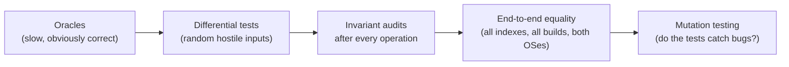

# 08 — Testing and correctness

> The rule of the project: **a faster structure may never give a different
> answer.** This document explains how that is established, with real test names
> and counts. Sources: `tests/`, `tools/`, `.github/workflows/`, `docs/TESTING.md`,
> `docs/DEFECT_LOG.md`, `docs/final/TESTING_AND_BENCHMARKS.md`.

## 1. Results at a glance (re-run 2026-11-02)

| Check | Command | Result |
|---|---|---|
| Unit, property, differential, golden, platform, API, HTTP | `make test` | **51 files, 12,166 checks, 0 failed** |
| End to end over real HTTP | `make e2e` | **38 checks** (30 demo mode + 8 public mode) |
| Mutation testing | `make mutation` | **28 / 28 injected bugs caught** (23 engine + 5 platform) |
| Full gate | `make validate` | docs, results tables, `-Werror`, tests, determinism, e2e, UBSan, CMake + ctest, Make-vs-CMake byte-identical |
| CI on the final commit | GitHub Actions run 41447026033 | all 9 gating jobs pass; bench gates all "ok" |

## 2. The five layers of evidence

### 2.1 Oracles
| Fast structure | Oracle |
|---|---|
| Quadtree, R-tree, geohash | `BruteForceIndex` |
| AVL interval tree | linear scan of all intervals |
| Persistent quadtree | full-table replay of every past version |
| Ray casting | winding number |
| Sweep-line self-intersection | O(V²) pairwise scan |
| k-d tree nearest node | `RoadGraph::nearest_node_linear()` with the same metric |
| Union-find components | flood fill (`components_bruteforce`) |
| Hungarian | exhaustive search on small matrices |

### 2.2 Differential tests — `tests/index/differential_test.cpp` (109 checks)
About **55,000 randomised queries per index** over **seven hostile workloads**:
identical boxes, zero-area boxes, touching edges, both hemispheres, poles, past
longitude 180, far inserts — mixed with inserts, removals and rebuilds. Every
answer must equal brute force. Related: `index/churn` (41), `index/equivalence`
(38), `index/geohash` (21), `index/serialization` (40),
`index/persistence_differential` (9), `index/versioned_index` (37),
`index/kd_tree` (1,982).

### 2.3 Invariant audits
Each core structure has `check_invariants()` and it runs **after every
operation** in those tests:
| Structure | Invariant |
|---|---|
| Quadtree | children tile the parent exactly; items lie in their node; straddlers fit no child |
| R-tree | node box = MBR of children; leaves at one depth; fill ≤ M |
| Interval tree | BST order on (low, high, value, seq); AVL balance; `max_high` correct; height ≤ 1.44 log₂(n+2) |
| Persistent index | versions immutable; validity log ordered by version |
| Hash map | live + tombstone counts; every key reachable from its home slot |

### 2.4 End-to-end equality and determinism
- `tests/fence/index_independence_test.cpp` (22): the whole engine emits
  **byte-identical event streams** under all four indexes.
- `tests/golden/*`: `determinism` (40), `scenario_replay` (3), `hysteresis_ab` (11),
  `incident_formation` (5) — same seed, same bytes.
- `make determinism`: Make (`-O2`) and CMake (`-O3`) binaries produce identical output.
- CI `cross-platform`: the dashboard built on macOS (Apple clang, libc++) and on
  Ubuntu (g++, libstdc++) must be **byte for byte identical**. `-ffp-contract=off`
  prevents fused multiply-add from changing a last bit (which once flipped an
  inside/outside test).

### 2.5 Mutation testing — `tools/mutation_check.py`
The tool applies **one realistic bug at a time** to a copy of the source tree,
rebuilds, and runs the tests named for it. A mutant is **killed** if any test
fails; a survivor fails the run. (It waits a wall-clock second between edits
because macOS `make` compares timestamps to the second.)

| # | Mutant (abridged) | Area |
|---|---|---|
| 1 | incident ranking has no id tie-break (platform-dependent order) | alerts |
| 2–4 | quadtree query skips the NE child; collapse loses grandchildren; root expansion misplaces the old root | quadtree |
| 5–6 | R-tree insert does not grow the node box; remove drops orphans instead of reinserting | R-tree |
| 7–9 | interval tree `max_high` ignores the right subtree; skips the left-right double rotation; prune off by one | interval tree |
| 10–12 | persistent index filters history with today's validity; accepts out-of-order commit times; re-add duplicates instead of replacing | persistent index |
| 13–15 | evaluator never reconciles zones outside the candidate window; processes candidates in index order; ignores validity windows | evaluator |
| 16–17 | hysteresis lets an Uncertain fix complete a pending exit; passes the Uncertain band straight through | hysteresis |
| 18–21 | ray casting ignores holes; containment ignores the GPS uncertainty radius; on-boundary tolerance back to an absolute cross product; query box drops the 1/cos(lat) longitude stretch | geometry |
| 22–26 | platform accepts fixes without consent; evaluates out-of-order fixes; responder keeps location access after the incident resolves; operator can give consent for a tourist; reconciler admits a retried batch twice | platform (5) |
| 27–28 | sweep line looks at only the immediate neighbour; tests only the first non-exempt neighbour on insert | sweep line |

**Why it matters:** "all tests pass" proves nothing if the tests cannot fail.
28/28 killed means each of these realistic bugs would be caught.

## 3. Other test families

| Area | Tests (checks) | What they pin |
|---|---|---|
| Geometry | `geo/ray_casting` (35), `geo/polygon_holes` (52), `geo/containment_uncertainty` (10), `geo/sweep_line` (56), `geo/wraparound` (19), `geo/projection` (14), `geo/bbox_around` (10) | vertex/edge rays, holes, uncertainty band, self-intersection, antimeridian refusal, projection error, conservative query box |
| Engine | `fence/hysteresis` (15), `fence/state_reconciliation` (18), `fence/evaluator_agreement` (20), `fence/zone_roundtrip` (37) | flap suppression, missed-exit bug, agreement of policies, GeoJSON round trip |
| Data structures | `ds/hash_table` (6,691), `ds/interval_tree` (185), `ds/priority_queue` (156), `ds/timer_wheel` (164), `ds/dynamic_connectivity` (50), `ds/circular_buffer` (10) | |
| Graphs | `graph/shortest_path` (815), `graph/matching` (443), `graph/road_graph_io` (66), `dispatch/assigner` (363) | Dijkstra = A* cost; Hungarian optimal; I/O |
| Alerts | `alert/correlator` (9), `alert/incident_lifecycle` (39), `alert/incident_ranking` (12), `alert/triage_escalation` (48) | |
| Platform and API | `app/api` (131), `app/multi_user` (80), `app/scenario` (52), `app/crypto` (21), `net/http_parse` (26) | isolation, consent, ingestion boundary, access control sweep, CSRF, rate limits, proxy address, scenario stories, PBKDF2/HMAC vectors (RFC 7914 / 4231), HTTP limits |
| Other | `sync/lamport` (20), `sync/offline_scenario` (9), `evidence/merkle_log` (18), `evidence/digital_id` (17), `group/cohesion` (3), `track/anomaly` (10), `jurisdiction/hierarchy` (30), `util/json` (54) | |
| End to end | `tools/api_e2e.py` (38) | starts the real server on a free port: roles, slow client cut at 20 s, public mode refuses to start without secrets, Secure cookie + HSTS, client address from the proxy only, rate limiting, clean SIGTERM, no secret in output |

## 4. Sanitizers, warnings, analysis, CI

| Tool | Where |
|---|---|
| UBSan (incl. `float-cast-overflow`, which g++ omits from `undefined`) | `make validate`; CI |
| ASan + UBSan | CI `sanitize` job (Linux) |
| `-Werror` with clang and g++ 13 | CI `test` and `clang` jobs |
| Clang Static Analyzer | CI `clang`: 0 findings |
| CMake + ctest 51/51, Make-vs-CMake byte-identical | CI `cmake` |
| macOS build + tests + UBSan | CI `macos` |
| Mutation 28/28 | CI `mutation` |
| Benchmark gates (informational timings) | CI `bench` |
| Dashboard byte-identical across OSes | CI `cross-platform` |
| HTTP parser fuzzing | a scratch harness (400,000 mutated requests, UBSan): no crash or UB — not committed |

## 5. How the project proves the optimised index returns the brute-force answer

1. **Same interface:** all indexes implement `index::SpatialIndex::query(box, out)`.
2. **Same inputs:** differential tests feed identical random hostile workloads.
3. **Set equality** after sorting, ~55,000 queries per index.
4. **Invariants** audited after every insert/remove/rebuild.
5. **Whole-engine equality:** byte-identical events under every index.
6. **Benchmark checksums** must match for every contender.
7. **Mutation testing** shows the tests would fail if a pruning rule were wrong
   (e.g. "quadtree query skips the NE child").
8. **In the Lab,** every spatial request shows "Mismatch vs brute: 0".

## 6. Significant defects found by testing (and fixed)

**Pass 6, hostile audit (`docs/DEFECT_LOG.md`) — the README's "ten real defects":**
| Defect | Effect | Fix / pin |
|---|---|---|
| State machine lost zones that left the candidate window | a fast exit was missed, then a silent re-entry | reconciliation step (`Evaluator::reconcile`); mutant "never reconciles" |
| Hysteresis let the Uncertain band through | ≈ 60 % of the demo's enter/exit events were flaps | Uncertain reported, never acted on; two hysteresis mutants |
| Hysteresis experiment could not tell a removed flap from a missed crossing | measurement defect | new metric with a target count |
| Query box not conservative | could miss a zone near the box edge | 1/cos(lat) stretch; mutant |
| "On the boundary" thicker on short edges | wrong containment near short edges | relative tolerance; mutant |
| Sweep line called some self-intersecting rings simple | invalid zones accepted | neighbour checks; two mutants |
| Interval-tree deletion broke ordering on exact duplicates | O(n) or wrong deletes | total key with `seq`; real AVL delete |
| Persistent quadtree mutations not what they claimed | history answers wrong | path copying and validity log fixed; three mutants |
| Zone loader converted untrusted numbers with UB | undefined behaviour on bad input | range checks before conversion |
| Benchmark headline not reproducible | measurement defect | the protocol in 07 §1 |

**Final verification (2026-11-01, `docs/final/SECURITY_AND_PRIVACY.md` §10):**
tourist isolation in shared incidents; responder positions and zone detail
readable by any user; unaudited views; unknown-username logins faster (timing
leak); unchecked number casts (UB on `1e999`); no request deadline; a handler
exception would end the process; `PATCH /users` applied only its first field;
no switch for Secure cookies — each fixed with a test that failed first.

**Deployment (2026-11-02):** a tourist got 400 instead of 403 on two admin-only
endpoints (role now checked before validation); the top bar overlapped at
760–1,050 px wide (found on the live site, fixed).

## 7. What is not covered (be honest)

- No browser-automation test suite; the console was checked by hand and with
  scripts in a browser, including on the live deployment.
- No external penetration test.
- No field trial with real GPS traces.
