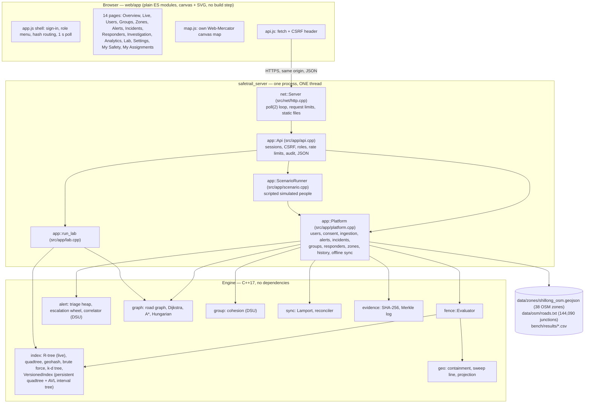
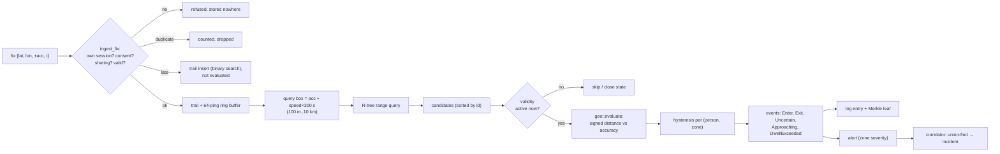
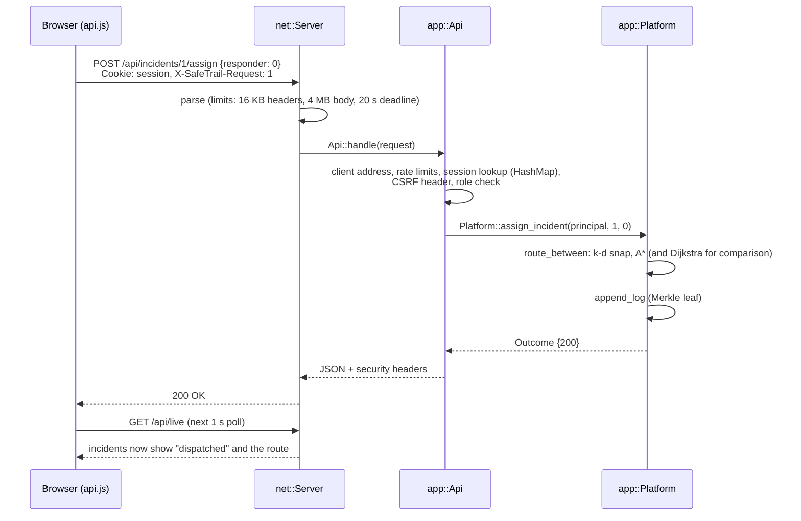
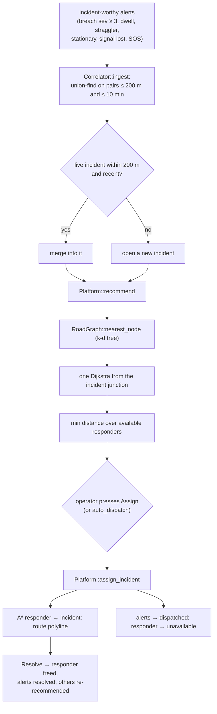
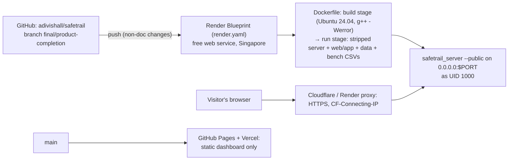

# 09 — System architecture

> How the pieces fit: browser, server, platform, engine, data, deployment. Four
> diagrams, then each layer. Deeper reference: `docs/final/ARCHITECTURE.md` and
> `docs/ARCHITECTURE.md`.

## 1. High-level architecture

## 2. GPS-to-event data flow

## 3. Frontend-to-backend request

## 4. Incident-to-responder dispatch

## 5. The layers

### 5.1 Frontend (`web/app/`)
- **No framework, no build step.** `index.html` loads `js/app.js` as an ES module.
- `util.js` builds DOM with `h(tag, props, ...kids)` and **`textContent` only**
  (no `innerHTML`, so user-supplied names cannot inject markup).
- State: `ctx.live` (the last `/api/live` snapshot) plus page-local variables;
  pages subscribe with `ctx.onLive(fn)` and unsubscribe on `destroy()`.
- Routing: URL hash (`#/zones/12`). Rendering: canvas for maps and the Lab; SVG
  for charts.
- The browser never computes containment, routing or anything else the engine
  does; it draws server answers. (The one exception is client-side *filtering*
  of already-loaded tables and the map's own click hit-test.)

### 5.2 Communication and API design
- **Same origin**, JSON over HTTPS (HTTP locally). The server also serves the
  static console files, so there is no CORS to configure — and no cross-origin
  request is ever approved.
- REST-like resources under `/api/`: `session`, `login`, `logout`, `live`,
  `users`, `groups`, `zones`, `alerts`, `incidents`, `dispatch/plan`,
  `responders`, `roads`, `history`, `events`, `evidence`, `audit`, `stats`,
  `settings`, `scenario`, `lab`, `bench`, `health`.
- Mutations are `POST` (actions such as `/ack`, `/assign`), `PATCH` (field
  updates) and `DELETE`; every mutation needs `X-SafeTrail-Request: 1`.
- Errors: `{"error": "..."}` with 400/401/403/404/409/411/413/429/431/500/501.
- Polling, not push: the console asks `/api/live` once a second.

### 5.3 Backend server (`src/net/http.cpp`, `apps/safetrail_server.cpp`)
- One thread, `poll(2)` event loop. Limits: header block ≤ 16 KB, ≤ 64 headers,
  body ≤ 4 MB (checked from Content-Length before buffering), chunked refused,
  15 s idle timeout, a request must be complete within 20 s, ≤ 256 connections.
- Between network events the loop calls a callback every 50 ms that advances the
  scenario runner (demo) or `Platform::tick()` with real time (production).
- `Platform::tick()`: anomaly detection, group cohesion every 10 s, escalation
  (timing wheel), retention and warning expiry every minute.
- SIGTERM sets a flag; the loop exits, prints `stopped.`, exits 0.

### 5.4 Core engine
`fence::Evaluator::evaluate()` — the per-fix pipeline (04 §2). It depends only on
the `index::SpatialIndex` interface, so any index can be plugged in (the platform
uses the R-tree; tests prove all four give identical events).

### 5.5 Data storage and state management
- **No database.** All state lives in memory inside one `Platform` object:
  vectors of users, alerts, incident cases, groups; per-user `Tracked` (trail
  vector, 64-ping ring buffer, per-zone states); the indexes; the logs.
- Single writer (one thread) → no locks, no races.
- Reference data loaded at start: zones (GeoJSON) and roads (text). The live
  R-tree is **STR-bulk-loaded** from the initial zones; edits insert/remove.
- Persistence is **not** implemented: a restart starts a fresh world (documented
  limitation; on the free host every wake is a restart).

### 5.6 Data ingestion
`Platform::ingest_fix()` is the single entry point for every fix — from the
tourist page, scenario people, or (in principle) a phone. Validation, ordering,
duplicates and jumps are handled before the engine sees the fix (04 §2 stages 3–4).

### 5.7 Spatial and temporal indexing
| Question | Structure |
|---|---|
| Which zones could contain this fix now? | R-tree (live), O(1) validity check per candidate |
| Which zones were in force at time t? | persistent quadtree version + AVL interval tree + validity log |
| Where was this user at time t? | binary search on the time-sorted trail |
| Nearest road junction | k-d tree |

### 5.8 Event processing
Events → log entries (each a Merkle leaf with a Lamport stamp) → alerts (with
triage and escalation) → incidents (correlation) → recommendation → assignment
→ resolution. Every state change is logged; alert and incident state histories
support "state at time t".

### 5.9 Routing
`graph::RoadGraph` adjacency list from OSM; recommendation by one Dijkstra;
routes by A*; batch plans by Hungarian over a Dijkstra cost matrix.

### 5.10 Security and authentication
| Control | Implementation |
|---|---|
| Passwords | PBKDF2-HMAC-SHA256, 16-byte salt, 120,000 iterations (10,000 on the public host, whose passwords are 256-bit random); own crypto checked against RFC vectors |
| Sessions | 256-bit tokens from `/dev/urandom`; server stores SHA-256(token); HttpOnly, SameSite=Strict, Secure on HTTPS; 30 min idle / 8 h absolute |
| CSRF | `X-SafeTrail-Request: 1` required on every mutation |
| Authorisation | role checks in every handler; location visibility by `may_view_location()`; consent only by the user |
| Audit | every location read by someone else → access log + its own Merkle log |
| Sign-in throttling | per address (10 / 5 min), per account+address (5 / 60 s), per account (25 / 60 s) |
| Public-mode rate limits | per address, per session, anonymous, Lab cost 5, server-wide sign-in cap |
| Browser hardening | CSP `default-src 'self'`, `X-Frame-Options: DENY`, `nosniff`, `Referrer-Policy: no-referrer`, `Permissions-Policy` denying geolocation/camera/mic, HSTS on HTTPS |
| Input | JSON depth limit; checked number conversion; GeoJSON validated all-or-nothing; static files allow-listed |

### 5.11 Deployment

Public mode (`--public`): passwords only from the four `SAFETRAIL_*_PASSWORD`
secrets (Render generates them), none printed; Secure cookies + HSTS; client
address from `CF-Connecting-IP` only when the connection comes from a private
(proxy) range; rate limits; labels everything simulated and temporary.

## 6. Technology stack, with reasons

| Technology | Reason |
|---|---|
| C++17, no third-party libraries | build the structures ourselves; predictable performance; the course's point |
| `make` + CMake | two independent builds of the same sources, checked byte-identical |
| Own HTTP server | no dependencies; single-threaded design keeps state simple |
| Plain JavaScript modules | nothing to install; small; safe DOM construction |
| Canvas map, SVG charts | no tile server or map library; works offline |
| OpenStreetMap data | real geography, free, reproducible extraction scripts |
| Python 3 tools (standard library only) | end-to-end test, mutation check, docs check, PDF build |
| Docker + Render free plan | free public hosting with HTTPS |
| GitHub Actions | g++ and clang on Linux, Apple clang on macOS, sanitizers, mutation, cross-platform byte check |
